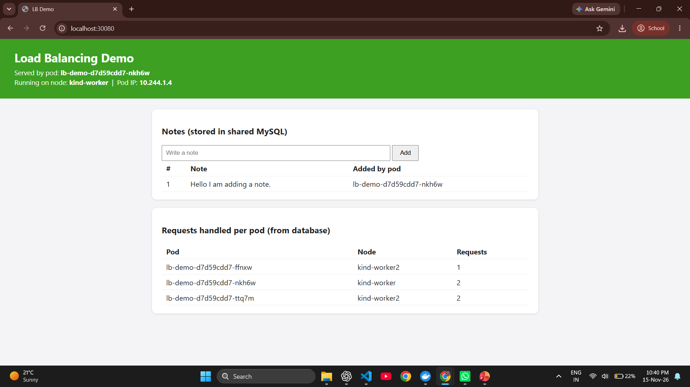
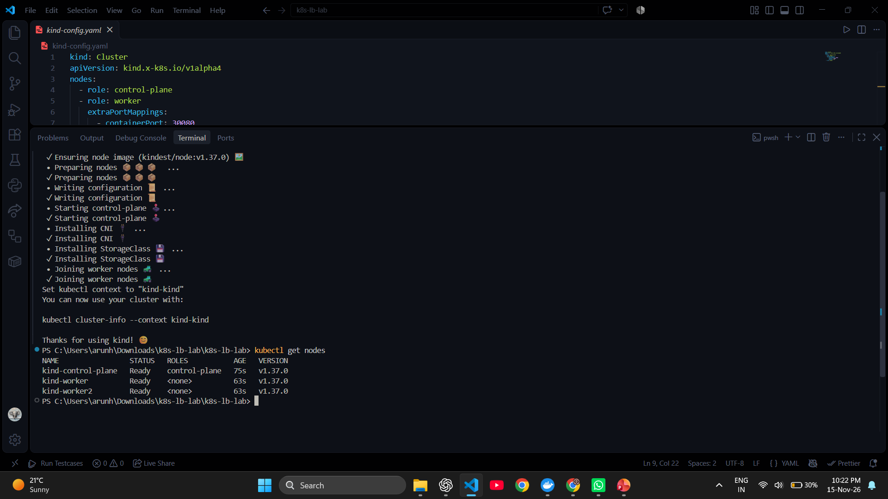
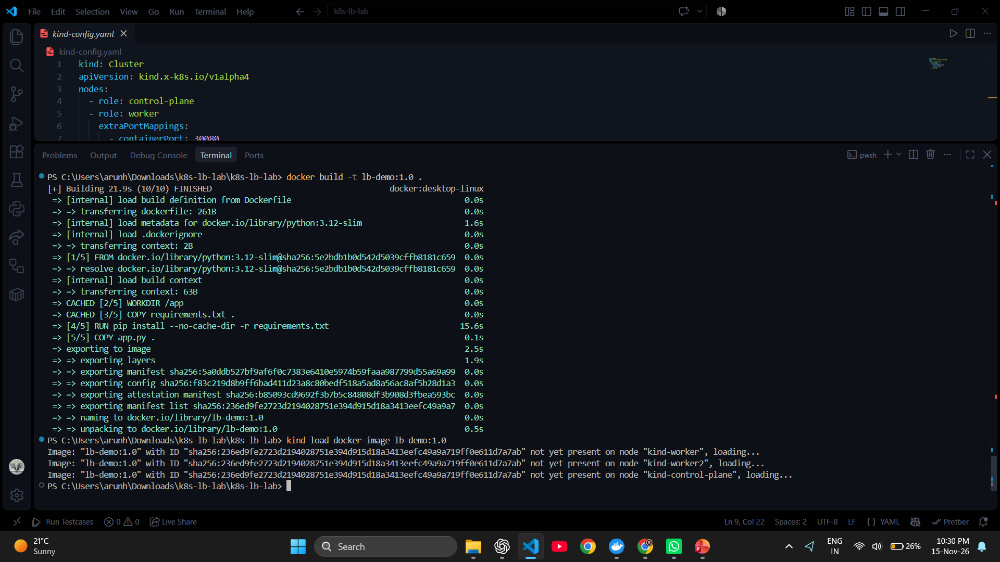
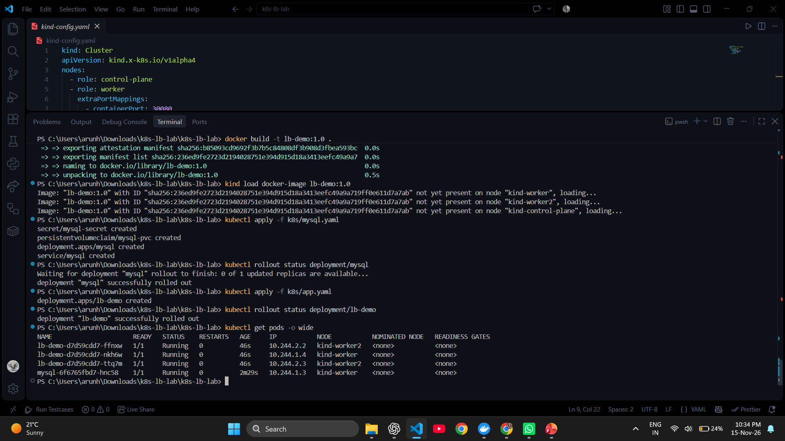
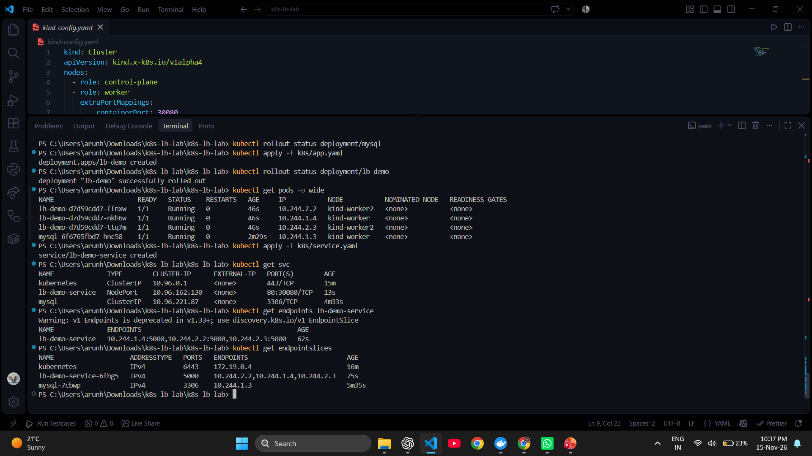
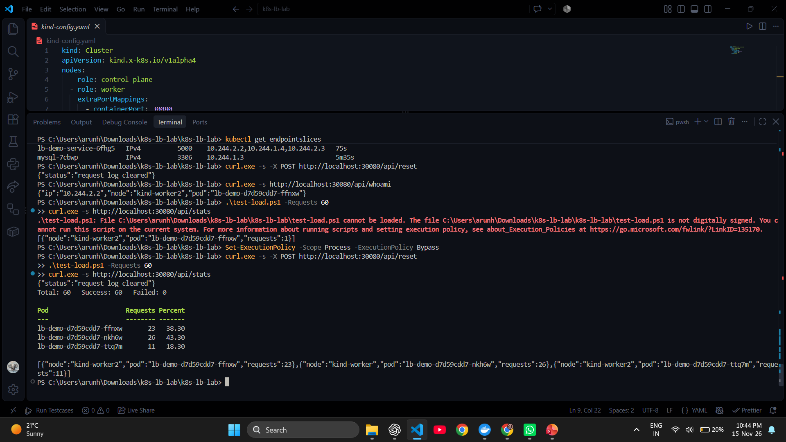
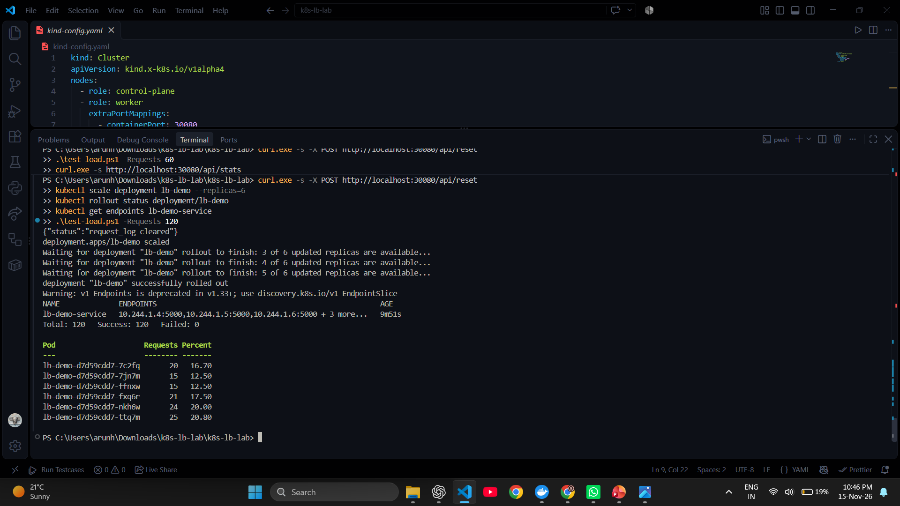
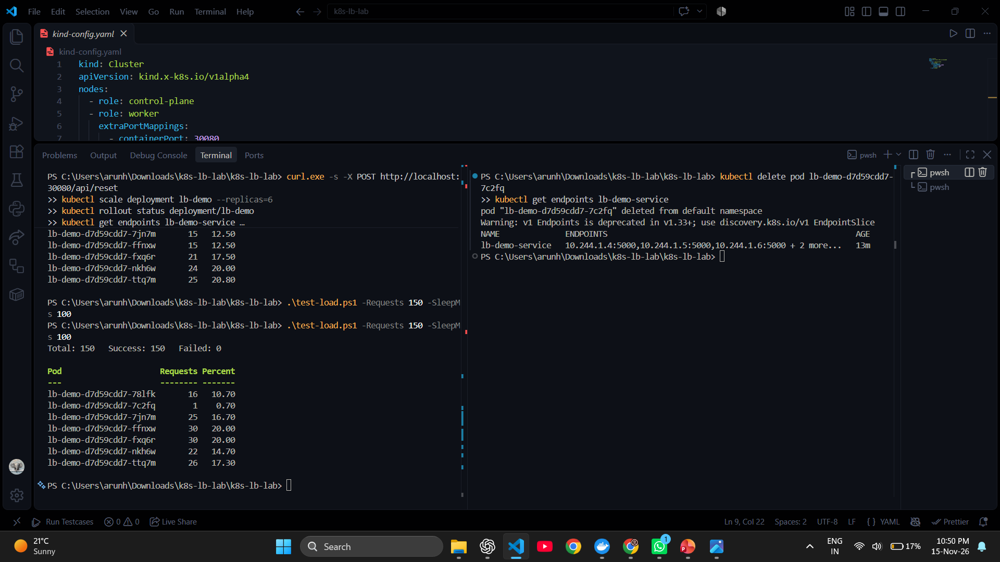
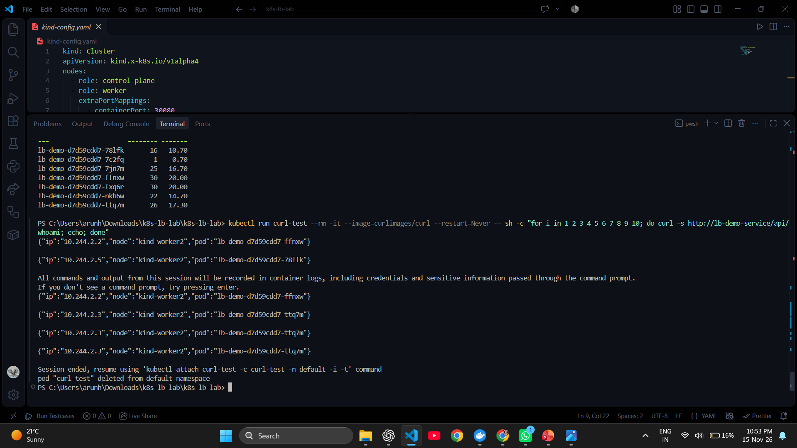

# Load Balancing Using Kubernetes Services

KLE Technological University | Cloud Computing Lab Evaluation 2 | Problem 03


## 1. Objective

Deploy multiple replicas of a web application, expose them through a Kubernetes Service, and demonstrate how incoming requests are distributed among the available pods.

What is demonstrated and measured:

- Number of requests handled by each pod
- Service reachability (from outside via NodePort, from inside via ClusterIP name)
- Replica availability (scaling and pod deletion during traffic)
- Response behaviour (success and failure counts)

## 2. Architecture

```
Laptop (browser / curl / test-load.ps1)
        |  http://localhost:30080
        v
Docker port mapping: laptop 30080 -> kind-worker container 30080
        |
        v
Service lb-demo-service (NodePort 30080, port 80 -> targetPort 5000)
  kube-proxy picks one ready pod at random for each new connection
        |
   +---------+---------+---------+
   v         v         v         v
  pod       pod       pod       ...   lb-demo web pods (3, later 6)
   |         |         |
   +---------+---------+
        |
        v
Service mysql (port 3306) -> MySQL pod (data on a PVC)
```


## 3. The application

A small Notes web application (Flask + MySQL). Every response reports the pod, node and IP that served it, and every request is logged in MySQL, so requests per pod can be counted in two independent ways (client side and database side).

| Part | Choice |
|---|---|
| Language / framework | Python 3.12, Flask |
| Web server | gunicorn (2 workers per pod) |
| Database | MySQL 8.0 (shared by all pods) |
| Cluster | kind, 1 control-plane + 2 workers, Kubernetes v1.37.0 |

Why MySQL and not SQLite: SQLite is a file inside each container, so every replica would have its own separate database. A shared MySQL service keeps the web tier stateless and allows one SQL query to count requests per pod.

### Routes

| Route | Method | Purpose |
|---|---|---|
| `/` | GET | Web page: serving pod, node, IP, notes form, requests-per-pod table |
| `/notes` | POST | Add a note (records which pod added it) |
| `/api/whoami` | GET | JSON with pod, node, ip (used by load tests) |
| `/api/stats` | GET | Requests per pod, counted from MySQL |
| `/api/reset` | POST | Clear the request log between experiments |
| `/health` | GET | Liveness probe |
| `/ready` | GET | Readiness probe (checks database connection) |



## 4. Project structure

```
k8s-lb-lab/
  app.py               Flask application
  requirements.txt     Pinned Python dependencies
  Dockerfile           Builds the image lb-demo:1.0
  kind-config.yaml     3-node cluster with port mapping 30080
  test-load.ps1        PowerShell load generator and counter
  README.md            This file
  k8s/
    mysql.yaml         Secret, PVC, MySQL Deployment, mysql Service
    app.yaml           lb-demo Deployment (3 replicas)
    service.yaml       lb-demo-service (NodePort 30080)
  screenshots/         Evidence images
  results/             Raw terminal output of each experiment
```

## 5. Prerequisites

- Windows 10/11 with WSL 2 and Docker Desktop (engine running)
- kubectl and kind installed
- PowerShell

## 6. How to run

### 6.1 Create the cluster

```powershell
kind create cluster --config kind-config.yaml
kubectl get nodes
```

`kind-config.yaml` maps container port 30080 on one worker to port 30080 on the laptop, so the NodePort is reachable at `http://localhost:30080`.



### 6.2 Build the image and load it into the cluster

```powershell
docker build -t lb-demo:1.0 .
kind load docker-image lb-demo:1.0
```

kind nodes are containers with their own image store, so the image must be loaded into them. The Deployment uses `imagePullPolicy: IfNotPresent` because the image does not exist on Docker Hub.



### 6.3 Deploy MySQL and the application

```powershell
kubectl apply -f k8s/mysql.yaml
kubectl rollout status deployment/mysql
kubectl apply -f k8s/app.yaml
kubectl rollout status deployment/lb-demo
kubectl get pods -o wide
```



### 6.4 Create the Service and verify endpoints

```powershell
kubectl apply -f k8s/service.yaml
kubectl get svc
kubectl get endpoints lb-demo-service
kubectl get endpointslices
```

The endpoint IPs (10.244.1.4, 10.244.2.2, 10.244.2.3 on port 5000) match the three lb-demo pod IPs, which shows the Service found its pods through the label selector `app: lb-demo`.



### 6.5 Allow the load-test script to run (this PowerShell window only)

```powershell
Set-ExecutionPolicy -Scope Process -ExecutionPolicy Bypass
```

## 7. Experiments and results

Before each experiment the counters were cleared:

```powershell
curl.exe -s -X POST http://localhost:30080/api/reset
```

`test-load.ps1` sends N requests to `/api/whoami` using `curl.exe` (a new connection per request), reads the pod name from each response and prints requests and percentage per pod.

### Experiment 1: Service reachability

```powershell
curl.exe -s http://localhost:30080/api/whoami
```

Result: `{"ip":"10.244.2.2","node":"kind-worker2","pod":"lb-demo-d7d59cdd7-ffnxw"}`

The Service is reachable from outside the cluster through the NodePort and the request was answered by an identifiable pod.

### Experiment 2: Distribution with 3 replicas (60 requests)

```powershell
.\test-load.ps1 -Requests 60
curl.exe -s http://localhost:30080/api/stats
```

| Pod | Node | Requests | Share |
|---|---|---|---|
| lb-demo-d7d59cdd7-ffnxw | kind-worker2 | 23 | 38.3% |
| lb-demo-d7d59cdd7-nkh6w | kind-worker | 26 | 43.3% |
| lb-demo-d7d59cdd7-ttq7m | kind-worker2 | 11 | 18.3% |

Total 60, success 60, failed 0. The database counts from `/api/stats` (23, 26, 11) match the script output exactly.



### Experiment 3: Scale to 6 replicas (120 requests)

```powershell
kubectl scale deployment lb-demo --replicas=6
kubectl rollout status deployment/lb-demo
kubectl get endpoints lb-demo-service
.\test-load.ps1 -Requests 120
```

| Pod | Requests | Share |
|---|---|---|
| lb-demo-d7d59cdd7-7c2fq | 20 | 16.7% |
| lb-demo-d7d59cdd7-7jn7m | 15 | 12.5% |
| lb-demo-d7d59cdd7-ffnxw | 15 | 12.5% |
| lb-demo-d7d59cdd7-fxq6r | 21 | 17.5% |
| lb-demo-d7d59cdd7-nkh6w | 24 | 20.0% |
| lb-demo-d7d59cdd7-ttq7m | 25 | 20.8% |

Total 120, success 120, failed 0. The endpoint list grew from 3 to 6 addresses automatically.



### Experiment 4: Replica availability (pod deleted during traffic, 150 requests)

Window 1:

```powershell
.\test-load.ps1 -Requests 150 -SleepMs 100
```

Window 2, while the test was running:

```powershell
kubectl delete pod <POD-NAME-YOU-DELETED>
kubectl get endpoints lb-demo-service
```

Deleted pod: `<fill in>`  Replacement pod: `<fill in>`

| Pod | Requests |
|---|---|
| lb-demo-d7d59cdd7-78lfk | 16 |
| lb-demo-d7d59cdd7-7c2fq | 1 |
| lb-demo-d7d59cdd7-7jn7m | 25 |
| lb-demo-d7d59cdd7-ffnxw | 30 |
| lb-demo-d7d59cdd7-fxq6r | 30 |
| lb-demo-d7d59cdd7-nkh6w | 22 |
| lb-demo-d7d59cdd7-ttq7m | 26 |

Total 150, success 150, failed 0. The Deployment created a replacement pod, the Service removed the deleted pod from its endpoints and added the new one once it was ready, and no request failed.



### Experiment 5: ClusterIP access from inside the cluster

```powershell
kubectl run curl-test --rm -it --image=curlimages/curl --restart=Never -- sh -c "sleep 5; for i in 1 2 3 4 5 6 7 8 9 10; do curl -s http://lb-demo-service/api/whoami; echo; done"
```

Responses came from several different pods (ffnxw, 78lfk and ttq7m appeared in the captured output), and the same pod answered three times in a row. A pod can reach the Service by its DNS name alone, which is the stable internal endpoint.



## 8. Analysis: why the results look like this

- **kube-proxy balances connections, not requests.** For each new connection it picks a backend. In iptables mode (the kind default) the choice is random with equal probability, not round-robin.
- **Random is only even in the long run.** 23 / 26 / 11 out of 60 is a normal random outcome. With 120 requests over 6 pods the spread was tighter (12.5% to 20.8%, ideal 16.7%).
- **curl instead of the browser.** A browser reuses one connection (keep-alive), so refreshes can keep hitting the same pod. `curl.exe` opens a new connection each time, so each request gets a fresh choice.
- **Only ready pods receive traffic.** The Service lists only pods that pass `/ready`, so deleted or unhealthy pods are skipped and new pods join once ready.
- **Traffic reached pods on both nodes** although port 30080 was mapped on only one worker, because kube-proxy forwards across nodes.
- **Scheduling and load balancing are separate.** The scheduler decides which node a pod runs on; the Service decides which pod handles a request.

## 9. Problems faced and fixes

| Problem | Cause | Fix |
|---|---|---|
| `docker build` failed with ReadTimeoutError | Network timeout while pip downloaded packages | Re-ran the build; cached layers were reused |
| `kind load` said image not present | Earlier build had failed | Rebuilt, then loaded again |
| `test-load.ps1` not digitally signed | PowerShell execution policy | `Set-ExecutionPolicy -Scope Process -ExecutionPolicy Bypass` |
| Endpoints deprecation warning | Newer Kubernetes prefers EndpointSlice | Also checked `kubectl get endpointslices` |

## 10. Conclusion

1. A Kubernetes Service gives a stable endpoint, reachable from outside (NodePort) and inside (ClusterIP DNS name), in front of changing pods.
2. Requests were distributed across all replicas (3 pods, then 6) with zero failed requests.
3. Distribution is random per connection, so it is not perfectly equal and approaches an even split as the request count grows.
4. Scaling is transparent: new pods joined the endpoint list automatically.
5. A pod deleted during traffic was replaced and no request failed.
6. Keeping the web tier stateless with one shared database is what makes replication safe.

## 11. Limitations and future work

- MySQL runs as a single-replica Deployment with a PVC. A StatefulSet is the usual production choice for databases.
- The application is a two-tier design, not full microservices (notes, stats and frontend could be split into separate services).
- Secrets are plain YAML, which is acceptable for a lab only.
- Possible additions: session affinity, an Ingress controller, a rolling update to a new image version, and a UI button with a live chart for requests per pod.

## 12. Cleanup

```powershell
kubectl delete -f k8s/service.yaml
kubectl delete -f k8s/app.yaml
kubectl delete -f k8s/mysql.yaml
kind delete cluster
```
